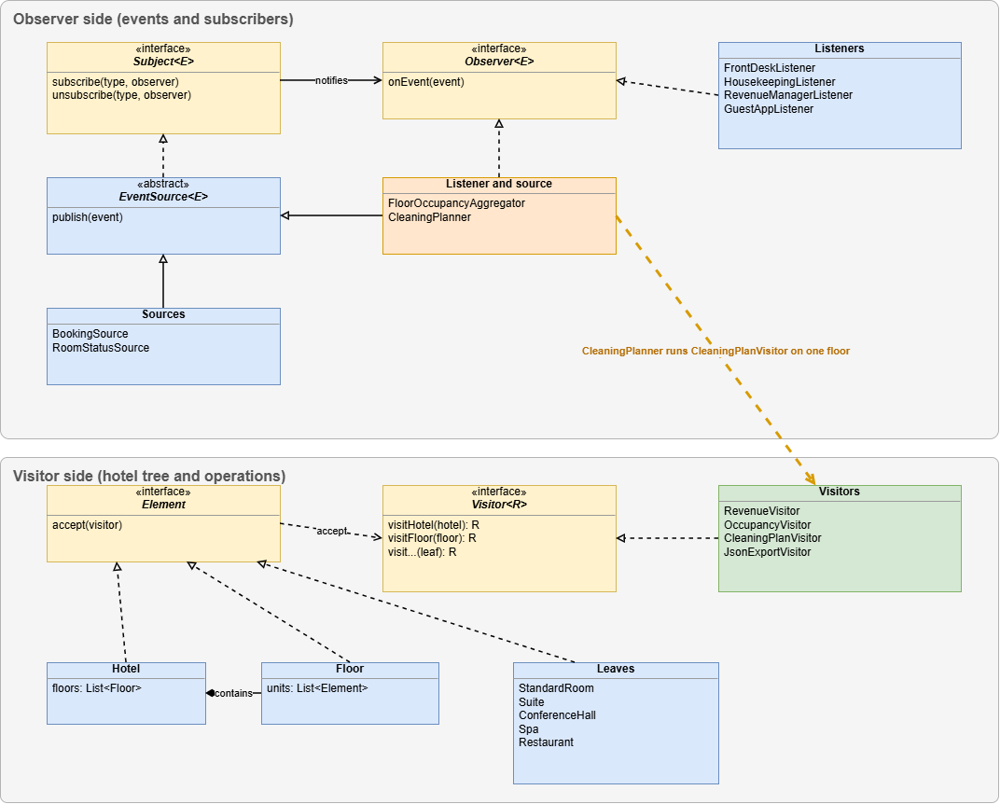

# Hotel Management: Observer and Visitor
## Assignment 6
## Name: Gulim Zhumabay
## Group: SE_2539

## Overview

The system combines two patterns. With Observer, sources publish booking and room status events to listeners. With Visitor, the hotel is a tree and operations such as revenue or a cleaning plan are run on it.

The two parts are connected. When a guest checks out, the room becomes dirty. A visitor then builds the cleaning plan only for the floor of that room, and the plan goes back into the system as a new event.

## How to run

* Tests: mvn test
* Demo: run hotel.Main. The optional first argument is the number of producer threads (3 by default).

## Project structure

* src/main/java/hotel
    * Main.java: composition root
    * event: event types and event records
    * observer: Subject, Observer, ListenerRegistry, EventSource, BookingSource, RoomStatusSource
    * listener: all listeners
    * model: the hotel tree
    * visitor: Visitor and all visitors
    * service: FloorLocator
    * simulation: SimulationRunner (producer threads)
* src/test/java/hotel: tests
* docs: UML diagram

## Observer design

* Two sources: BookingSource and RoomStatusSource.
* Listeners: FrontDeskListener, HousekeepingListener, RevenueManagerListener, GuestAppListener and FloorOccupancyAggregator. CleaningPlanner, CleaningTaskBoard and HotelStateUpdater are used for the integration.
* Events are Java records, so they are immutable, and each has an EventType. A listener subscribes to one type and can subscribe or unsubscribe at any time. Subject and Observer are my own generic interfaces.
* ListenerRegistry uses a ConcurrentHashMap of CopyOnWriteArrayLists. Publishing goes through a snapshot of the list, so a listener can unsubscribe even inside its own handler. Subscribing is more expensive because the list is copied, but it happens rarely.
* Chain of observers: FloorOccupancyAggregator listens to check-in and check-out events, counts occupied rooms per floor and publishes the result as a new event.
* I chose push. The event carries all the data, so listeners do not call the source back. This avoids extra locking and reading state that another thread is changing.

## Visitor design

* The tree has three levels: Hotel, Floor, and the units on a floor. Hotel and Floor are containers. The leaves are StandardRoom, Suite, ConferenceHall, Restaurant and Spa. Element classes hold only data.
* Visitors: RevenueVisitor (a number), OccupancyVisitor (accumulates state over the whole tree), CleaningPlanVisitor (a filtered list) and JsonExportVisitor (JSON written by hand). RoomLookupVisitor and MostExpensiveUnitVisitor are extra.
* Double dispatch: the client calls element.accept(visitor), and each element calls the matching method of the visitor, for example visitor.visitSuite(this).
* The visitor does the traversal, not the tree. Every visitor combines the results of children in its own way (sum, counter, list, JSON), and a visitor can start on any node, which the integration needs. The cost is that the loop over children is repeated in each visitor.
* Other decisions: one composition root (Main), constructor injection only, and the base class EventSource so the sources do not repeat the same code.

## Integration

* BookingSource publishes guest checked out.
* HotelStateUpdater marks the room as free and dirty in the tree and publishes room dirty.
* CleaningPlanner receives it and runs CleaningPlanVisitor only on that floor.
* The result is published as a CleaningPlanEvent and CleaningTaskBoard stores it.

For the room cleaned event, HotelStateUpdater is subscribed before CleaningPlanner, so the dirty flag is already removed when the plan is built.

## Concurrency

* SimulationRunner starts producer threads on an ExecutorService. The number of producers and events is configurable.
* No synchronized blocks are used. Shared state uses concurrent collections, AtomicInteger, ConcurrentHashMap.compute and volatile flags.
* Shutdown: the runner waits for every task, then calls shutdown and awaitTermination, and shutdownNow in a finally block. No events are lost and no threads stay alive.
* Known limits: the order of events republished by the aggregator is not guaranteed between threads (the counts are exact), and CleaningTaskBoard keeps the last plan it received.

## Trade-off proof

Commit a6a0154 adds a new visitor, MostExpensiveUnitVisitor:

* new: MostExpensiveUnitVisitor.java
* new: MostExpensiveUnitVisitorTest.java
* no existing file was changed

Commit 427a354 adds a new element type, Spa:

* new: Spa.java and SpaTest.java
* changed: Visitor.java, RevenueVisitor.java, OccupancyVisitor.java, CleaningPlanVisitor.java, JsonExportVisitor.java, RoomLookupVisitor.java, MostExpensiveUnitVisitor.java

A new operation costs one new class. A new element type costs a change in the Visitor interface and in every visitor, here 7 existing files for one new class, and the project does not compile until all of them are done. I would reject Visitor if new element types appeared often and the operations were few and stable.

## Tests

There are 28 tests, including a stress test with 4 producer threads and 1000 events each, which expects exactly 4000 delivered events. Visitor results are checked against values calculated by hand. For the sample hotel the revenue is 100 + 300 + 500 + 1000 = 1900, the occupancy is 3 of 4 units, and the cleaning plan is rooms 102 and H1.

## UML class diagram

## Commit history

The commits follow the order of building: events and interfaces, registry and sources, listeners, visitors, integration, threads, composition root, and the two trade-off commits. The full list is in git log.